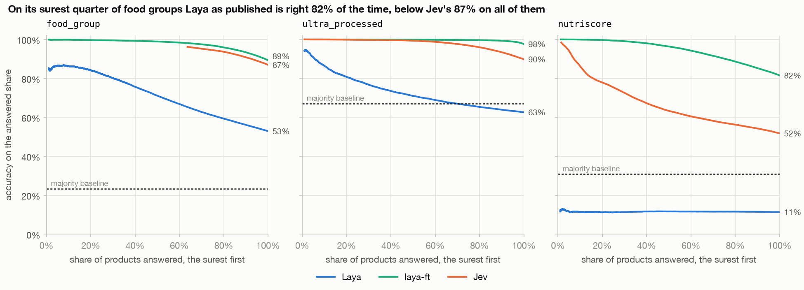

# Laya vs Jev on Open Food Facts

*Innovation Day, 30 October 2026*

## TL;DR

Out of the box, Laya can't replace Jev.
After fine-tuning on a DGX Spark, it beats Jev on all three questions we asked.

Both are decision models: instead of writing text, they pick an answer to a typed question and say how sure they are.
Jev is hosted by TypeSafe AI in the US, Laya is open source and small enough to run on a laptop.

I gave both of them 90_000 Open Food Facts products and asked three things about each one: 
- its food group, 
- whether it is ultra-processed, 
- and its Nutri-Score.

Open Food Facts already has the right answers.

Laya as published got 52.9% of the food groups right. On the other two questions it did worse than always giving the most common answer.
Fine-tuned on 10_000 other products kept out of the test, `laya-ft` got 89.2%, 97.6% and 81.5%, against Jev's 86.9%, 89.8% and 51.8%.
Its confidence is also the most honest of the three. Jev, for comparison, is 95% sure of its food groups on average and right 87% of the time.
Jev would cost about €33 per million products, and the whole experiment cost me $3.78 in Jev tokens.

For more details, have a look at the following notebooks, and [Results](#results) below has the details.

1. [data-sampling.ipynb](notebooks/data-sampling.ipynb)
2. [systems-check.ipynb](notebooks/systems-check.ipynb)
3. [harness-check.ipynb](notebooks/harness-check.ipynb)
4. [first-look.ipynb](notebooks/first-look.ipynb)
5. [results.ipynb](notebooks/results.ipynb)

## The idea

In September 2026 a new class of models appeared: System One models, also called decision models.
They **do not** generate text.
They read the input once and answer typed questions (`choice`, `noul` for yes/no, `score` for ordered levels) with a probability per option, in a single forward pass.

For a data engineering practice this is not a chatbot feature.
It is a new kind of transformation: a cheap, typed function with a confidence attached, that can run on every row of a table, like a UDF in Spark or SQL.

| | Jev | Laya |
| --- | --- | --- |
| Vendor | TypeSafe AI | Convai Innovations |
| Access | Closed, hosted API, US | Apache 2.0, self-hosted |
| Model | Architecture not published | ModernBERT-large encoder, 421M (English checkpoint) |
| Price | $0.042 per million input tokens (vendor figure) | Own hardware |
| Known weak spots | Numbers and dates (vendor docs) | Base checkpoints near chance zero-shot on typed decisions, over-confident as shipped, 512-token context |

---
## The goal of the day

The broader goal is to give our team early, hands-on experience with decision models.
If they turn out to be valuable, we want to be among the early adopters, with our own numbers rather than vendor claims.

**Measurable goal of the day:** can Laya, running on a local machine, replace Jev on every row of a table, and how much accuracy does that cost?

## Scope

### Data

[Open Food Facts](https://huggingface.co/datasets/openfoodfacts/product-database), the official parquet export on Hugging Face: `openfoodfacts/product-database` (8 GB, 4.88M products).

The sample is 100_000 English products with all three labels present, drawn with a fixed seed:

- rows 1-10_000 are the calibration split, used to fit Laya's temperature and to fine-tune Laya;
- rows 10_001-100_000 are the evaluation split, where every reported number comes from.

### Three questions, one request per product

| Question | Type | Ground truth | Why it is in |
| --- | --- | --- | --- |
| `food_group` | `choice` | Level-1 tag in `food_groups_tags` (about 9 groups) | The main metric: a human-curated taxonomy, not a rule |
| `ultra_processed` | `noul` | `nova_group == 4` | NOVA in Open Food Facts is computed by rules from ingredients, so this is "model vs regex" |
| `nutriscore` | `score` | `nutriscore_grade`, `A` to `E` | Expected to fail: the grade is a function of numbers, a known weak spot. It shows where the boundary is |

### A third system: Laya fine-tuned

Laya's documentation says its base checkpoints need fine-tuning on domain data, so the comparison has a third system, `laya-ft`.

- It is the same English checkpoint, fine-tuned on the 10_000 calibration products with Laya's own training code, on an NVIDIA DGX Spark: see [finetune/](finetune/README.md).
- It is served like the published checkpoint, by the same `laya-serve`, and answers the same evaluation products with the same questions.
- Its temperatures are fitted during training, on 1_500 calibration items held out from it.
- 15.1% of the evaluation products have the name of a calibration product, ignoring case, so its accuracy is also reported for those products and for the rest apart.

### What is measured

- Accuracy per question and per system on the evaluation split, next to the majority-class baseline.
- What fine-tuning changes: Laya against `laya-ft`, for products whose name was trained on and for the rest.
- Where Laya and Jev disagree, and examples of each kind of disagreement.
- Calibration: reliability of Laya's confidence before and after temperature fitting, and Jev's as shipped.
- Accuracy against coverage for Laya: how accurate it is on the share of rows it is most confident about.
- Throughput and cost: rows per second for Laya on an M3 Pro laptop, latency and € per million rows for Jev from measured token counts.
  The laptop's speed is measured on the 1_024 products of the first look; the full Laya runs are answered on the DGX Spark, to finish in time.
- How far the Spark's answers are from the laptop's, on those 1_024 products, so the change of device is measured rather than assumed away.

### Out of scope

- Generative LLM baselines, Strands Decider, Clef and the OpenAI Decisions API.
- Tuning the fine-tuning: `laya-ft` is one run with Laya's published recipe, not a search over settings.
- The multilingual checkpoint and non-English products.
- Any cloud, Kubernetes or table-format work: that is the Innovation Project, not the day.
- Publishing Jev numbers outside Xebia until TypeSafe's terms on benchmarks are read.

## Predictions, written before the runs

Fill these in before the first request is sent.
The `laya-ft` column was added on 31 October, after the first look at 1_024 calibration products; it is filled in before the training run starts.

| Question | Baseline | Laya accuracy | Jev accuracy | `laya-ft` accuracy |
| --- | --- | --- | --- | --- |
| `food_group` | 22% | 60% | 70% | 72% |
| `ultra_processed` | 70% | 65% | 80% | 82% |
| `nutriscore` | 28% | 25% | 35% | 40% |

Why these numbers:

- `food_group`: sugary snacks should be the largest group in packaged English products, which are mostly US imports.
  Laya is reported near chance zero-shot, but naming a food group from a product name is semantic enough to land well above the 11% of a random guess.
  Jev should lose its points on taxonomy edges (composite foods vs cereals, salty vs sugary snacks), not on understanding.
- `ultra_processed`: most packaged products are NOVA 4, so the baseline is high and hard to beat.
  The label is a rule over ingredient markers, which a model approximates but does not replicate.
  Laya also reads only 512 tokens, and the longest ingredient lists, with the additives at the end, are exactly the NOVA 4 ones.
- `nutriscore`: the grade is a formula over numbers, a known weak spot for both systems, and only the exact grade counts.
  Laya should land at or below the baseline, Jev slightly above it.

## The sample

274_159 products pass the filter; the sample is 100_000 of them, drawn with the seed `laya-vs-jev-2026-10-30`.
How it is built and checked is in [data-sampling.ipynb](notebooks/data-sampling.ipynb).

Majority baselines, measured on the evaluation split (90_000 rows):

| Question | Majority answer | Baseline | Predicted |
| --- | --- | --- | --- |
| `food_group` | sugary snacks | 23.3% | 22% |
| `ultra_processed` | yes (NOVA 4) | 67.0% | 70% |
| `nutriscore` | E | 30.8% | 28% |

- 10 level-1 food groups remain, not 9: alcoholic beverages has only 3 evaluation rows, too few to score, and is reported as such.
- Baby foods and milks does not survive the filter at all.

## Systems under test

Pinned on 31 October 2026:

| System | Version | Read from |
| --- | --- | --- |
| Laya | `laya 0.4.18`, English checkpoint revision `7b928d8`, on MPS on the laptop and CUDA on the DGX Spark for the full runs | `/health` of the server |
| Jev | `jev-1.14.0` | the `model` field of a `jev-latest` response; `jev-latest` was released on 22 October 2026 |
| Laya fine-tuned | `laya 0.4.18, laya-ft@c4b23c4`, on CUDA on the DGX Spark | the first 7 characters of the SHA-256 of the weights the harness serves; a local checkpoint has no commit |

Both answer [request.json](request.json) with the same response shape: the same answer types, field names and `usage` block.
Differences that matter for the analysis:

- Jev returns probabilities with 2 decimals, Laya with 4, so Jev's confidence comes in coarse steps and many rows tie at 1.0.
- Each system counts input tokens with its own tokenizer (866 for Jev, 671 for Laya on `request.json`), so the counts are not comparable between them.
- Laya's `model` field says `laya-rl-agent`, so its `model_version` comes from `/health`.
- Jev only accepts `choice` options as a dictionary of descriptions; Laya also accepts a plain list.
- Laya answers about 5 products per second on the M3 Pro, so a full run of 100_000 takes about 5.5 hours; batching barely helps.
  The full runs of Laya and `laya-ft` are therefore answered on the DGX Spark, with the same locked versions, checkpoints, questions and batches.

Every check above can be re-run, and tried on other products, in [systems-check.ipynb](notebooks/systems-check.ipynb).

## Harness

The code that sends the sample to both systems is in [harness/](harness/).
[harness-check.ipynb](notebooks/harness-check.ipynb) checks it on a 20-row dry run per system.

- Both systems get the questions from [request.json](request.json) through one client; only the base URL, the model and the API key differ.
- Laya goes through `/v1/systemone/batch`, 64 states per call, sorted by length into passes of 16.
- Jev goes through `/v1/systemone`, with 4 requests in flight and at most 600 per minute, half its published limit.
- Every response is appended to a raw log under `data/runs/<run>/` as it arrives, so a stopped run continues where it stopped and the analysis never needs a second call.
- A run is pinned to its model version, route, batch settings, questions and rows, and refuses to continue with any of them changed.
- A failed request is retried with backoff; a product that still fails keeps its rows in the results, with the error.
- The strict Laya server does not report truncation, so the harness counts it with Laya's own code and tokenizer; the count matches a non-strict Laya exactly.

`just run jev` starts Jev's full run from the laptop, about 2.8 hours.
`just run laya` and `just run laya-ft full --split evaluation` run on the DGX Spark, next to its own Laya servers, and `just spark-pull` copies their raw logs back, as [finetune/README.md](finetune/README.md) describes.
On the laptop's Laya the same commands would take about 5.5 hours each.
`just build` then writes `data/runs/full/results.parquet`, one row per product, system and question:

| Column | Holds |
| --- | --- |
| `id`, `split` | the sample row |
| `system`, `model_version` | `laya 0.4.18, english@7b928d8`, `jev-1.14.0` or `laya 0.4.18, laya-ft@c4b23c4` |
| `question`, `answer` | the question, and its most likely option |
| `probs` | the probability of every option |
| `latency_ms` | per product; a Laya batch call's time is shared by its products, and in the full run it is the DGX Spark's |
| `input_tokens` | per product, counted by each system's own tokenizer |
| `truncated`, `state_tokens_dropped` | Laya only: the state did not fit next to this question |
| `attempts`, `error` | the attempts a product took, and the error if it never got an answer |

Truncation depends only on the input, so it is known before the runs.
On the evaluation split Laya cuts 2.8% of the states for `food_group`, which leaves the state 329 tokens, and 0.9% and 0.8% for `nutriscore` and `ultra_processed`.
99% of the cut states are NOVA 4.

## First look

Before the full runs, [first-look.ipynb](notebooks/first-look.ipynb) explains the baselines and the first differences between Laya and Jev, on the first 1_024 calibration products.
Its numbers are not results: those come from the evaluation split.

## Results

[results.ipynb](notebooks/results.ipynb) computes every number below from the 90_000 products of the evaluation split; the calibration split only fits Laya's temperature.
No product failed, so every accuracy is over all 90_000 of them.
The Jev numbers stay inside Xebia until TypeSafe's terms on publishing benchmarks have been read.

| Question | Majority baseline | Laya | `laya-ft` | Jev |
| --- | --- | --- | --- | --- |
| `food_group` | 23.3% | 52.9% | **89.2%** | 86.9% |
| `ultra_processed` | 67.0% | 62.6% | **97.6%** | 89.8% |
| `nutriscore` | 30.8% | 11.4% | **81.5%** | 51.8% |

| | Laya | `laya-ft` | Jev |
| --- | --- | --- | --- |
| Products per second | 5.0 on the M3 Pro laptop, 25.2 on the DGX Spark | 25.1 on the DGX Spark | 9.7, the harness's own cap of 600 requests a minute |
| A million products | 56 hours of the laptop, or 11 of the Spark | 11 hours of the Spark | €33 ($37) in input tokens |

- **Fine-tuning decides it.**
  `laya-ft` is the most accurate system on all three questions, 2.3, 7.8 and 29.7 points ahead of Jev.
- **It learned the task, not the products.**
  On the 76_413 evaluation products whose name it never saw, it is still ahead of Jev on all three questions.
  Beyond what Jev also gains on the other 15.1%, having seen a name adds at most 0.4 points to its overall accuracy.
- **Laya as published does not answer these questions.**
  It is below the majority baseline on `ultra_processed` and `nutriscore`, and answers B for 91% of the `nutriscore` products.
  Its `nutriscore` probabilities carry no information: fitted on the calibration split, its temperature runs off towards infinity, and Laya caps it at 5.
- **Confidence.**
  `laya-ft`'s confidence is the most honest on all three questions, with a calibration error (ECE) of 0.023, 0.008 and 0.033.
  Jev is over-confident on `food_group`, 95% sure on average and right 87% of the time, and on `nutriscore`, 63% against 52%.
  Fitting Laya's temperature brings its calibration error on `ultra_processed` from 0.101 to 0.030.
- **Cut states.**
  The nutrition line comes last in every state, so it is the first thing Laya's 512 tokens leave out.
  On the 798 products whose state is cut for `nutriscore`, `laya-ft` falls from 81.7% to 56.6%, below Jev's 61.2% on the same products.
- **The device.**
  On the 1_024 products of the first look, sent in the same batches, the DGX Spark changes 18, 8 and 2 of the laptop's answers, and accuracy by at most 0.4 points.
- **Jev's cost** is its 888 input tokens per product at $0.042 per million, output tokens being free, converted at the ECB rate of 30 October 2026.
  The bill for every Jev request of the experiment, 102_068 products with the dry runs and the first look, was $3.78, within 1% of what the token counts in the responses predict at that price.
  Its latency per request is 162 ms at the median and 238 ms at p95.

A system can answer only the products it is surest about and leave the rest: the share it answers is the coverage.
On its surest quarter of food groups Laya as published is right 82% of the time, still below Jev's 87% on all of them.
On their surest three quarters, `laya-ft` is right 96.8% of the time on `food_group` and Jev 94.5%.

### Against the predictions

Measured minus predicted accuracy, in points:

| Question | Majority baseline | Laya | `laya-ft` | Jev |
| --- | --- | --- | --- | --- |
| `food_group` | +1.3 | -7.1 | +17.2 | +16.9 |
| `ultra_processed` | -3.0 | -2.4 | +15.6 | +9.8 |
| `nutriscore` | +2.8 | -13.6 | +41.5 | +16.8 |

- The baselines were guessed within 3 points.
- Laya as published did worse than predicted on every question, most on `nutriscore`, where it was expected near the baseline and landed below a random guess.
- Jev and `laya-ft` did far better than predicted everywhere.
  The largest miss is `laya-ft` on `nutriscore`, predicted 40% and measured 81.5%: the grade is a formula over the nutrition numbers, and fine-tuning taught Laya to read them.

## Expected output

By the end of the day this folder holds:

1. **The results table**: accuracy per question for Laya, `laya-ft` and Jev, plus Laya rows per second and Jev € per million rows.
2. **One chart**: Laya accuracy against coverage.
3. **Three failure modes**, each with real rows from the sample as examples.
4. **Predictions against results**: where the guesses above were wrong, and by how much.
5. **One line for the pitch**: own accuracy and speed, ready to paste into the Innovation Projects draft.

A negative result counts.
"Laya zero-shot reaches X% on food groups, fine-tuning is required" is a finding and a line for the pitch.

## Caveats known in advance

- Laya's base checkpoints are over-confident as shipped, so raw confidence cannot be read as a probability until the temperature is fitted.
- The English Laya checkpoint reads 512 tokens, so long ingredient lists are cut.
- Option order changes Laya's answers; the stretch item in [todo.md](todo.md) measures it.
- Laya and Jev figures above come from vendor pages and secondary reviews, not from our measurements.
- The sample is a derived database under the ODbL licence of Open Food Facts; keep the attribution if it is ever published.

## References

- [XKE S3 LLMs in 2026 (demo part)](https://xebiagroup.sharepoint.com/:v:/r/sites/Xebia-Data/_layouts/15/stream.aspx?id=%2Fsites%2FXebia%2DData%2FShared%20Documents%2FKnowledge%20sharing%2FXKE%20recordings%2FBuilding%20an%20LLM%20Series%2FS3%20%2D%20LLMs%20in%202026%20Transformers%2C%20Mixture%20of%20Experts%20and%20System%20One%20Solutions%2D20261027%5F180332%2DMeeting%20Recording%2Emp4&share=cQp2QNbgTjUHSL2BO4UthXgnEgUCdv9aSXdeELyGZ7w7%5FZE1Hg)
- [Laya on GitHub](https://github.com/NandhaKishorM/laya) - checkpoints, serving, calibration, limitations
- [Open Food Facts on Hugging Face](https://huggingface.co/datasets/openfoodfacts/product-database)
- [TypeSafe Jev pricing, limits and benchmarks](https://www.developersdigest.tech/blog/typesafe-jev-system-one-models-release-guide-2026)
- [Laya: the open-source Jev alternative, benchmarked](https://flowtivity.ai/blog/laya-open-source-jev-alternative/)
