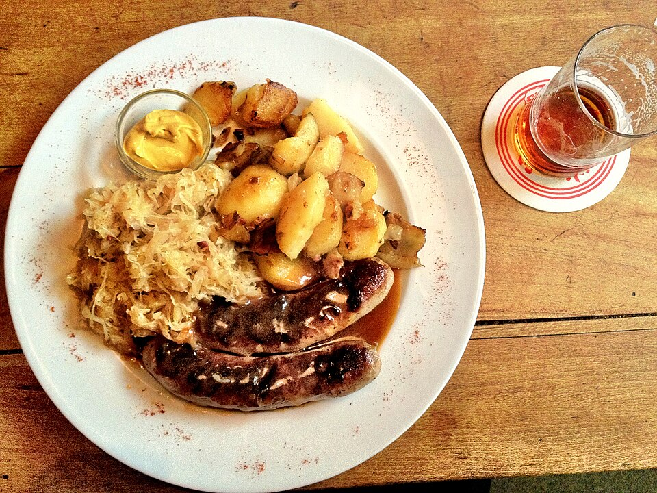
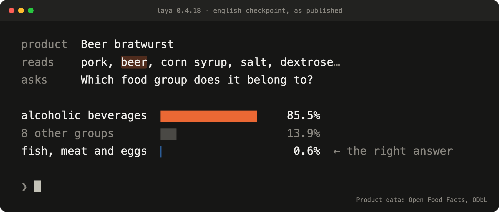
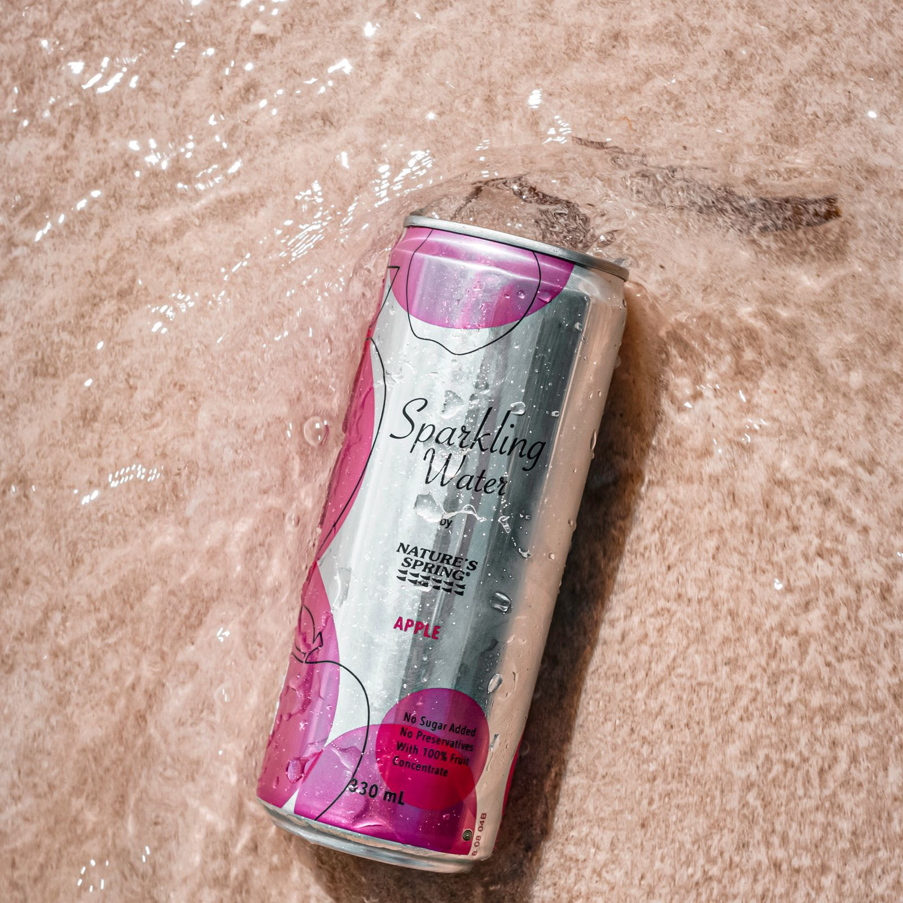
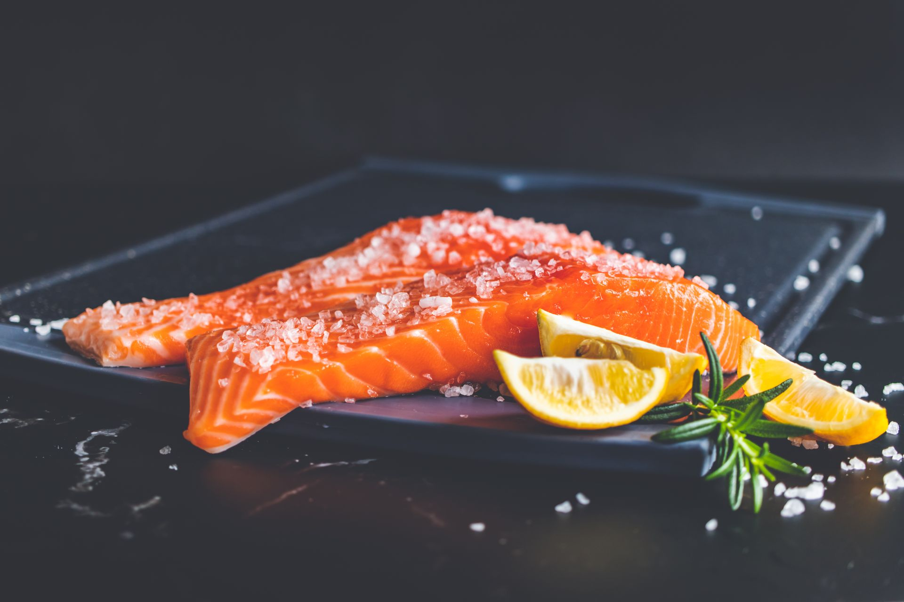

*Only one of these is a drink (photo by [Dominik Schwind](https://commons.wikimedia.org/wiki/File:Bratwurst_with_sauerkraut,_potatoes_and_beer.jpg), [CC BY 2.0](https://creativecommons.org/licenses/by/2.0/)).*

Send the label of a beer bratwurst to Laya, an open-source decision model, and it will answer with 86% confidence that this is an alcoholic drink.
While beer is the second ingredient, the right answer is `fish, meat and eggs`.

<!--  -->

After 87 minutes of finetuning on a sample of 10,000 other groceries, the same model put the bratwurst where it belongs with 97% confidence.
On another 90,000 products, it will be right more often than a paid model, on every single question.

This post is about how to achieve that, what the cost is, and what it will require you to run this kind of AI models yourself.

## The quiet kind of AI

Nowadays, most of the AI models in the news are generative models.
Chatbots, coding assistants and agents write something based on a user-given prompt.

The models in this post don't write a word.
They receive an information about the state and questions with a fixed list of answers, and they give back a confidence level for every answer, all at once.
An information about the state might sound vague, but it can be text, image, audio or other types of information. 

These models are called decision models, or System One models.
They get a fraction of the attention frontier models get, and I think they deserve more, at least from people like me who build data pipelines for enterprises.

There are many System One models emerging from labs, but the following two make the most noise:

- **Jev (TypeSafe AI)** - a closed model behind an API.
- **Laya (Convai Innovations)** - an open-source alternative to Jev.

## Which one is better?

It depends on what "better" means.
The obvious answer is accuracy: which one gets more answers right.
But a model inside a data pipeline is also a bill, a speed and a dependency.

### Jev means renting

You get an API key, pay $0.042 per million input tokens, and stop thinking about GPUs and infrastructure.
Every row you send goes to someone else's servers, though.
And your pipeline gets one more external dependency that you don't control.
You can pin a version, but TypeSafe decides how long that version stays available, and what it costs.

### Laya means owning

The weights are under Apache 2.0, and you are responsible for the model's lifecycle, from installing to serving and retiring it.

For a list of groceries, where the data goes doesn't matter much.
For customer tickets, contracts or payments, sending every row to a third-party service is a question of your enterprise architecture.

So the question is: can Laya, running on your own hardware (in my case, a laptop and the DGX Spark at our office), match Jev's performance?

## How do you ask these models questions?

Fortunately, both models speak the same protocol.
TypeSafe developed it for Jev, and Laya copied it, the same way most of the LLM servers today accept requests in OpenAI's format.
So a client written for Jev works with Laya too.

A request for these models is a piece of text, called the state, and a list of questions.
This is the bratwurst, sent as a `POST` to `https://api.typesafe.ai/v1/systemone`:

```json
{
  "model": "jev-1.14.0",
  "state": "Product: Beer bratwurst\nIngredients: Pork, beer, contains 2% or less of corn syrup, salt, dextrose, flavorings, bha, bht, citric acid.\nNutrition per 100 g: energy 325 kcal, fat 25 g, saturated fat 8.75 g, sugars 2.5 g, salt 2.75 g, fibre 0 g, proteins 22.5 g",
  "questions": {
    "food_group": {
      "type": "choice",
      "instructions": "Which food group does this product belong to?",
      "criteria": {
        "alcoholic beverages": "beer, wine, cider, spirits and other drinks with alcohol",
        "beverages": "non-alcoholic drinks: sodas, juices and nectars, waters, teas and coffees, plant-based milk substitutes",
        ...
        "fish, meat and eggs": "meat, processed meat, fish and seafood, eggs",
        ...
      }
    },
    "ultra_processed": {
      "type": "noul",
      "instructions": "Is this product ultra-processed, NOVA group 4?",
      "criteria": {
        "true": "ultra-processed: an industrial formulation with additives such as flavourings, colours, emulsifiers or sweeteners",
        "false": "not ultra-processed: unprocessed, minimally processed, a culinary ingredient or a simply processed food"
      }
    },
    "nutriscore": {
      "type": "score",
      "instructions": "What is the Nutri-Score of this product, from A (best nutritional quality) to E (worst)?",
      "criteria": [
        "A: best nutritional quality",
        "B: good nutritional quality",
        "C: average nutritional quality",
        "D: poor nutritional quality",
        "E: worst nutritional quality"
      ]
    }
  }
}
```

Every question has one of three types:

- `choice` - pick one of a set of named options, in the example above the food group of the product;
- `noul` - yes or no, answered with the probability of yes;
- `score` - pick a level on an ordered scale, here the Nutri-Score from `A` to `E`.

A `score` looks like a `choice` with five options, but for a `score` the order of the levels is part of the question.
That is why its criteria come as an ordered list, and not as a dictionary of named options.
Next to the probability of every level, the answer carries one more number: the average level, weighted by those probabilities.
On a scale where `A` is 0 and `E` is 4, a 3.4 means "between `D` and `E`, closer to `D`".
A `choice` has no such number, because there is no average of "beverages" and "salty snacks".

You can ask as many questions per request as you like, as long as the request fits into the model's context.
Interestingly, the order matters for a `choice` too, where it shouldn't: Laya's answers change when you shuffle the options.

## Open Food Facts

To grade a model you need the right answers, and labelling thousands of products by hand is a costly process.

[Open Food Facts](https://world.openfoodfacts.org) has done it already.
It is a free database of food products built by volunteers, 4.88 million of them, and many come with three labels that work as an answer key:

1. **Food group**, one of ten, from `"sugary snacks"` to `"fish, meat and eggs"`.
2. **Ultra-processed or not**, yes or no.
3. **Nutri-Score**, the A to E grade on the front of many packages in Europe.

### Sampling 100,000 products

Open Food Facts publishes the whole database as one parquet file on [Hugging Face](https://huggingface.co/datasets/openfoodfacts/product-database).

I kept the products with an English name and ingredient list, and with all three labels filled in.
That leaves 274,159 products.
From those I took 100,000 at random.
10,000 of them I put aside for finetuning, and the other 90,000 are the test.

Every number in this post comes from those 90,000.

## Who gets more answers right?

One more thing to settle before the first request: a baseline.
If your model always gives the most common answer, it will be

- right 23.3% of the time with `sugary snacks`,
- 67.0% with `ultra-processed`, and
- 30.8% with `E`.

A model that can't beat that is no use.

### What kind of food is this?

I asked Laya as published, Laya Base from here on, and it got 52.9% of the food groups right.
That cleared the bar of 23.3%, but it was nowhere near Jev's 86.9%.

It had strong opinions.
It filed 36% of all products under `fats and sauces`, where 12% belong.
It was confident that 660 products are alcoholic drinks among 90,000, where only 3 items were real alcoholic drinks.
On the other two questions it did **worse** than the baseline.

None of this would surprise Laya's authors.
That's an expected outcome.
Their documentation says the base model has to be trained on your own data before it is good at your questions.

Training here means showing the model a sample of the dataset, with the right answers, and letting it adjust itself a little bit.
Laya ships the code for finetuning [here](https://github.com/NandhaKishorM/laya/blob/main/laya/train.py).
And it took 87 minutes on our NVIDIA DGX Spark at the office to finetune Laya on the 10,000 training examples.

The finetuned version of Laya got 89.2% of the food groups right, against Jev's 86.9%.

<p>
<table style="border-collapse: collapse; width: 100%;">
  <thead>
    <tr>
      <th style="border: 1px solid #ccc; padding: 6px 8px; text-align: left;">Beer bratwurst</th>
      <th style="border: 1px solid #ccc; padding: 6px 8px; text-align: left;">Answer</th>
      <th style="border: 1px solid #ccc; padding: 6px 8px; text-align: left;">Confidence</th>
    </tr>
  </thead>
  <tbody>
    <tr>
      <td style="border: 1px solid #ccc; padding: 6px 8px;">Laya Base</td>
      <td style="border: 1px solid #ccc; padding: 6px 8px;">alcoholic beverages</td>
      <td style="border: 1px solid #ccc; padding: 6px 8px;">86%</td>
    </tr>
    <tr>
      <td style="border: 1px solid #ccc; padding: 6px 8px;">Laya Finetuned</td>
      <td style="border: 1px solid #ccc; padding: 6px 8px;">fish, meat and eggs</td>
      <td style="border: 1px solid #ccc; padding: 6px 8px;">97%</td>
    </tr>
    <tr>
      <td style="border: 1px solid #ccc; padding: 6px 8px;">Jev</td>
      <td style="border: 1px solid #ccc; padding: 6px 8px;">fish, meat and eggs</td>
      <td style="border: 1px solid #ccc; padding: 6px 8px;">100%</td>
    </tr>
  </tbody>
</table>
</p>

### Is the seltzer ultra-processed?


*Photo by [Cesan Escuadro](https://www.pexels.com/photo/tin-can-drink-on-shallow-water-5766604/) on Pexels.*

This is the full ingredient list of a can of seltzer:

- carbonated water
- natural flavor

It doesn't sound ultra-processed, and in Jev's opinion it is not ultra-processed, with 54% confidence.
Laya Finetuned says yes with 97% confidence, and Open Food Facts confirms it.

<p>
<table style="border-collapse: collapse; width: 100%;">
  <thead>
    <tr>
      <th style="border: 1px solid #ccc; padding: 6px 8px; text-align: left;">Seltzer</th>
      <th style="border: 1px solid #ccc; padding: 6px 8px; text-align: left;">Answer</th>
      <th style="border: 1px solid #ccc; padding: 6px 8px; text-align: left;">Confidence</th>
    </tr>
  </thead>
  <tbody>
    <tr>
      <td style="border: 1px solid #ccc; padding: 6px 8px;">Laya Base</td>
      <td style="border: 1px solid #ccc; padding: 6px 8px;">no</td>
      <td style="border: 1px solid #ccc; padding: 6px 8px;">69%</td>
    </tr>
    <tr>
      <td style="border: 1px solid #ccc; padding: 6px 8px;">Laya Finetuned</td>
      <td style="border: 1px solid #ccc; padding: 6px 8px;">yes</td>
      <td style="border: 1px solid #ccc; padding: 6px 8px;">97%</td>
    </tr>
    <tr>
      <td style="border: 1px solid #ccc; padding: 6px 8px;">Jev</td>
      <td style="border: 1px solid #ccc; padding: 6px 8px;">no</td>
      <td style="border: 1px solid #ccc; padding: 6px 8px;">54%</td>
    </tr>
  </tbody>
</table>
</p>

[NOVA](https://world.openfoodfacts.org/nova) sorts food into four groups by how processed it is, and group 4 is ultra-processed.
Open Food Facts doesn't ask a nutritionist about each of its millions of products.
It applies defined rules that look for certain ingredients in the list, such as flavourings, colours, emulsifiers and sweeteners.
"Natural flavor" is one of them, so the seltzer is group 4.
The same rule makes a bottle of rapeseed oil ultra-processed because of one anti-foaming agent in it.

This is the first hint of what training buys.

> A general model knows what words mean in the world.
>
> A trained one knows what they mean in your data, house rules included.

### What is the Nutri-Score of smoked salmon?


*Photo by [Anastasia Yudin](https://www.pexels.com/photo/raw-salmon-and-lemon-wedges-5014597/) on Pexels.*

Smoked salmon:

- pink salmon
- salt
- brown sugar
- natural wood smoke

Per 100 g it has 22 g of protein and 3.5 g of fat.

It might sound like an `A` or a `B`, but according to Open Food Facts it is a `D`.
Jev thinks it is a `B`, but Laya Finetuned agrees with Open Food Facts.

<p>
<table style="border-collapse: collapse; width: 100%;">
  <thead>
    <tr>
      <th style="border: 1px solid #ccc; padding: 6px 8px; text-align: left;">Smoked salmon</th>
      <th style="border: 1px solid #ccc; padding: 6px 8px; text-align: left;">Answer</th>
      <th style="border: 1px solid #ccc; padding: 6px 8px; text-align: left;">Confidence</th>
    </tr>
  </thead>
  <tbody>
    <tr>
      <td style="border: 1px solid #ccc; padding: 6px 8px;">Laya Base</td>
      <td style="border: 1px solid #ccc; padding: 6px 8px;">B</td>
      <td style="border: 1px solid #ccc; padding: 6px 8px;">54%</td>
    </tr>
    <tr>
      <td style="border: 1px solid #ccc; padding: 6px 8px;">Laya Finetuned</td>
      <td style="border: 1px solid #ccc; padding: 6px 8px;">D</td>
      <td style="border: 1px solid #ccc; padding: 6px 8px;">90%</td>
    </tr>
    <tr>
      <td style="border: 1px solid #ccc; padding: 6px 8px;">Jev</td>
      <td style="border: 1px solid #ccc; padding: 6px 8px;">B</td>
      <td style="border: 1px solid #ccc; padding: 6px 8px;">58%</td>
    </tr>
  </tbody>
</table>
</p>

The `D` comes from the salt, 2.93 g per 100 g is too much.
Nutri-Score is a strict formula, and it doesn't care about a food's reputation.
Energy, sugar, saturated fat and salt count against a product.
Fibre, protein, and fruit and vegetables count for it.

Jev's mistakes look like mistakes of reputation, and they repeat across whole families of products:

<p>
<table style="border-collapse: collapse; width: 100%;">
  <thead>
    <tr>
      <th style="border: 1px solid #ccc; padding: 6px 8px; text-align: left;">Products</th>
      <th style="border: 1px solid #ccc; padding: 6px 8px; text-align: left;">How many</th>
      <th style="border: 1px solid #ccc; padding: 6px 8px; text-align: left;">Most common grade</th>
      <th style="border: 1px solid #ccc; padding: 6px 8px; text-align: left;">Jev's most common answer</th>
      <th style="border: 1px solid #ccc; padding: 6px 8px; text-align: left;">Jev right</th>
      <th style="border: 1px solid #ccc; padding: 6px 8px; text-align: left;">Laya Finetuned right</th>
    </tr>
  </thead>
  <tbody>
    <tr>
      <td style="border: 1px solid #ccc; padding: 6px 8px;">smoked salmon</td>
      <td style="border: 1px solid #ccc; padding: 6px 8px;">67</td>
      <td style="border: 1px solid #ccc; padding: 6px 8px;">D</td>
      <td style="border: 1px solid #ccc; padding: 6px 8px;">B</td>
      <td style="border: 1px solid #ccc; padding: 6px 8px;">27%</td>
      <td style="border: 1px solid #ccc; padding: 6px 8px;">81%</td>
    </tr>
    <tr>
      <td style="border: 1px solid #ccc; padding: 6px 8px;">turkey breast</td>
      <td style="border: 1px solid #ccc; padding: 6px 8px;">290</td>
      <td style="border: 1px solid #ccc; padding: 6px 8px;">D</td>
      <td style="border: 1px solid #ccc; padding: 6px 8px;">B</td>
      <td style="border: 1px solid #ccc; padding: 6px 8px;">25%</td>
      <td style="border: 1px solid #ccc; padding: 6px 8px;">91%</td>
    </tr>
    <tr>
      <td style="border: 1px solid #ccc; padding: 6px 8px;">olive oil</td>
      <td style="border: 1px solid #ccc; padding: 6px 8px;">506</td>
      <td style="border: 1px solid #ccc; padding: 6px 8px;">B</td>
      <td style="border: 1px solid #ccc; padding: 6px 8px;">B or D, half each</td>
      <td style="border: 1px solid #ccc; padding: 6px 8px;">42%</td>
      <td style="border: 1px solid #ccc; padding: 6px 8px;">72%</td>
    </tr>
  </tbody>
</table>
</p>

Smoked fish and sliced turkey sound healthy, and their salt pushes them down.
Olive oil is pure fat, and the rules for fats and oils give it a B anyway.

Overall, Jev got 51.8% of the grades exactly right.
Laya Base answered `B` for nine products out of ten.
Only one product in nine is a `B`, so it got 11.4% right, worse than a random guess at 20%.
Laya Finetuned got 81.5% of the grades exactly right, and 98.3% within one grade.
That still leaves almost one product in five with the wrong grade, so there is room for improvement.
Its weak spot is long states: Laya reads at most 512 tokens, and the nutrition line comes last.
On the 798 products where the cut reaches it, Laya Finetuned drops to 56.6%, below Jev's 61.2%.

## The receipt

Accuracy is only part of the decision.
The rest is what you pay, how long you wait, and whether you can finetune the weights.

**Money.**
Jev charges for the text you send, $0.042 per million input tokens, and $0.0 for output tokens.
The bill for the whole experiment, 102,068 products including the test runs, was $3.78.
At that rate a million products would cost about €33.
Laya has no bill, only a machine to run it on.

**Time.**
On my laptop (MacBook M3 Pro) the throughput was about 5 requests per second on Laya, which is 56 hours for a million requests.
The NVIDIA DGX Spark at our office does 25 per second, which is 11 hours.
Jev answers in 162 ms at the median, and how many products you can send per minute is set by its rate limit.
At half of it, 9.7 products per second, a million takes about 29 hours; at the full limit, about 14.

**Trust.**
A percentage is only useful if "90% confidence" means right about nine times in ten.
Jev is overconfident: on food groups its average confidence was 95%, but it was right only 87% of the time.
On Nutri-Score its average confidence was 63%, and it was right 52% of the time.

Laya Finetuned never had a confidence of 100%: its highest was 99.3%.
On average it was 88.7% sure, and right 89.2% of the time.

## So, what is the answer?

The question was: can Laya, running on your own hardware, match Jev's performance?

Out of the box, `no`.
Laya Base beats the baseline on one question out of three, and its documentation warns about it.

After finetuning, the answer is `yes`, at least on this data: Laya Finetuned beat Jev on all three questions.
And its lead grows from question to question:

- 2.3 points on food groups, a question about `meaning`;
- 7.8 points on ultra-processed, a question about a `rule`;
- 29.7 points on Nutri-Score, a question about a `formula`.

The further a label is from everyday meaning, and the closer to a house rule, the more 10,000 examples are worth.

This is one dataset, English products only, and one training run with the default recipe.
Open Food Facts' labels are not perfect either, so some of Jev's mistakes are probably the database's.

> Rule of thumb: if you have around 10,000 rows labelled the way your business labels them, try training a small open model before you rent one.
> If you don't, rent.

The bratwurst, for the record, is back with the meat.

## Your turn: can you do the same with Jira tickets?

Groceries were a convenient test, because Open Food Facts gives away the answer key.
Most enterprise pipelines don't carry bratwursts, though, they carry tickets.
So here is a challenge: repeat this experiment on Jira issues, and find out if a finetuned Laya beats Jev there too.

The data exists.
[The Public Jira Dataset](https://doi.org/10.5281/zenodo.5882881) holds 2.7 million issues from 16 public Jira instances, under CC BY 4.0.
Apache's Jira alone has a million of them, across 657 projects.
Every resolved issue comes with three labels that fit the three question types:

- `choice` - the issue type: `Bug`, `Improvement`, `New Feature`, `Task` and so on;
- `noul` - was the issue resolved as `Fixed`, and not as `Won't Fix`, `Duplicate` or `Cannot Reproduce`;
- `score` - the priority, an ordered scale from `Trivial` to `Blocker`.

Here is the [harness](https://github.com/godatadriven/laya-vs-jev-on-open-food-facts-dataset).

## The fine print

<p>
<table style="border-collapse: collapse; width: 100%;">
  <thead>
    <tr>
      <th style="border: 1px solid #ccc; padding: 6px 8px; text-align: left;">Question</th>
      <th style="border: 1px solid #ccc; padding: 6px 8px; text-align: left;">Baseline</th>
      <th style="border: 1px solid #ccc; padding: 6px 8px; text-align: left;">Laya Base</th>
      <th style="border: 1px solid #ccc; padding: 6px 8px; text-align: left;">Laya Finetuned</th>
      <th style="border: 1px solid #ccc; padding: 6px 8px; text-align: left;">Jev</th>
    </tr>
  </thead>
  <tbody>
    <tr>
      <td style="border: 1px solid #ccc; padding: 6px 8px;">Food group</td>
      <td style="border: 1px solid #ccc; padding: 6px 8px;">23.3%</td>
      <td style="border: 1px solid #ccc; padding: 6px 8px;">52.9%</td>
      <td style="border: 1px solid #ccc; padding: 6px 8px;"><strong>89.2%</strong></td>
      <td style="border: 1px solid #ccc; padding: 6px 8px;">86.9%</td>
    </tr>
    <tr>
      <td style="border: 1px solid #ccc; padding: 6px 8px;">Ultra-processed</td>
      <td style="border: 1px solid #ccc; padding: 6px 8px;">67.0%</td>
      <td style="border: 1px solid #ccc; padding: 6px 8px;">62.6%</td>
      <td style="border: 1px solid #ccc; padding: 6px 8px;"><strong>97.6%</strong></td>
      <td style="border: 1px solid #ccc; padding: 6px 8px;">89.8%</td>
    </tr>
    <tr>
      <td style="border: 1px solid #ccc; padding: 6px 8px;">Nutri-Score</td>
      <td style="border: 1px solid #ccc; padding: 6px 8px;">30.8%</td>
      <td style="border: 1px solid #ccc; padding: 6px 8px;">11.4%</td>
      <td style="border: 1px solid #ccc; padding: 6px 8px;"><strong>81.5%</strong></td>
      <td style="border: 1px solid #ccc; padding: 6px 8px;">51.8%</td>
    </tr>
  </tbody>
</table>
</p>

Product data comes from [Open Food Facts](https://world.openfoodfacts.org) and is available under the [Open Database License](https://opendatacommons.org/licenses/odbl/).
The sample used here is a derived database under the same licence.

- [The code, notebooks and results](https://github.com/godatadriven/laya-vs-jev-on-open-food-facts-dataset)
- [Laya on GitHub](https://github.com/NandhaKishorM/laya)
- [Introducing System One Models & Jev](https://typesafe.ai/blog/introducing-system-one-models-and-jev)
- [Open Food Facts on Hugging Face](https://huggingface.co/datasets/openfoodfacts/product-database)
- [The Public Jira Dataset on Zenodo](https://doi.org/10.5281/zenodo.5882881)